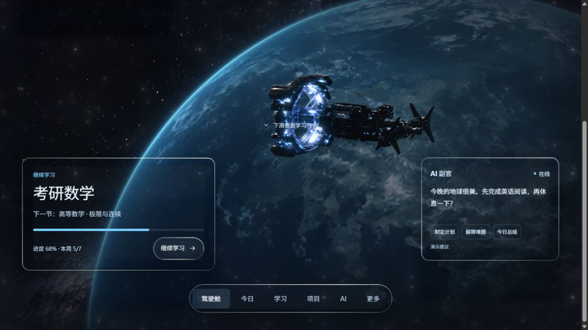

# CENTER 驾驶舱 · Liquid Glass

可运行的 React / TypeScript 太空驾驶舱，也是供 MagicPath 读取的最新源码参考。

## 本地运行

```bash
git clone https://github.com/aldonastal797-star/center-cockpit-liquid-glass.git
cd center-cockpit-liquid-glass
npm ci
npm run dev
```

打开终端显示的本地地址。验证与生产构建：

```bash
npm run check
npm run build
```

## 这版改动

- 使用 [rdev/liquid-glass-react](https://github.com/rdev/liquid-glass-react) 1.1.1 的原组件源码，提供边缘折射、色散、透光和弹性高光。适配层保持原生按钮与面板文字清晰。
- 原版 Framer 风格的多层柔光粒子：随机漂移、分层闪烁、预设、实时滑杆、设置保存及恢复默认。
- 首屏保留太空场景，学习、AI 与底部导航在下滑后出现。
- 航天器靠近时，星空、地球和航天器采用不同的镜头变换。
- 地球固定位置缓慢自转；光照跟随统一太阳方向，不再按纬度固定压暗。
- 场景素材和折射贴图均随仓库提供；有暂停、减少动态效果与兼容回退。

任务、学习进度和 AI 文本是演示数据；AI 示例没有连接模型服务。

## 给 MagicPath

先读 [MAGICPATH_HANDOFF.md](./MAGICPATH_HANDOFF.md)，再按其中列出的文件修改现有 CENTER。这里是最新验证版本；MagicPath 线上尚未同步这一版。

关键实现位于 `src/components/generated/`。图片位于 `public/assets/`。将素材接入 MagicPath 时，放入目标项目的 `assets/`，并保留 `assets/...` 引用以便其构建器处理。

## 验证

严格 TypeScript 检查和 Vite 生产构建通过。检查了桌面与手机布局、无横向溢出、粒子暂停、分层靠近、Esc 返回、预设与玻璃参数、刷新后保存设置。浏览器控制台未报告错误或警告。未进行真实设备性能基准；Safari / Firefox 的折射支持受原组件限制。



第三方组件来源和许可证见 [THIRD_PARTY_NOTICES.md](./THIRD_PARTY_NOTICES.md)。
