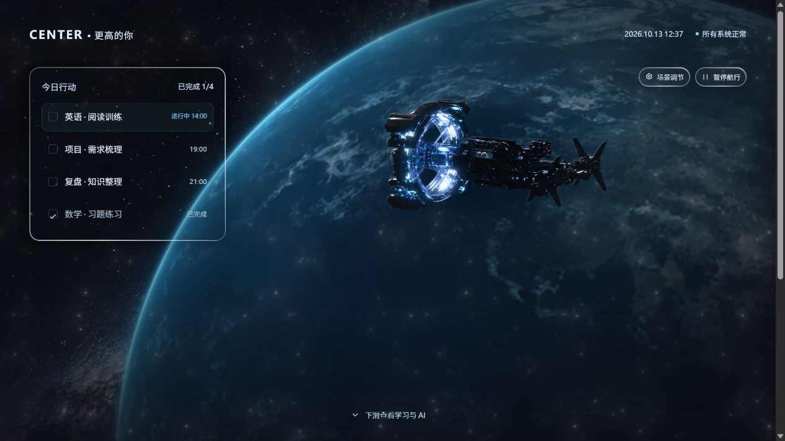

# CENTER 驾驶舱 · Liquid Glass

可运行的 React / TypeScript 太空驾驶舱，也是供 MagicPath 读取的最新源码参考。

## 本地运行

```bash
git clone https://github.com/aldonastal797-star/center-cockpit-liquid-glass.git
cd center-cockpit-liquid-glass
npm ci
npm run dev
```

打开终端显示的本地地址。验证与生产构建：

```bash
npm run check
npm run build
```

## 这版改动

- 使用 [rdev/liquid-glass-react](https://github.com/rdev/liquid-glass-react) 1.1.1 的原组件源码，提供边缘折射、色散、透光和弹性高光。适配层保持原生按钮与面板文字清晰。
- 原版 Framer 风格的多层柔光粒子：随机漂移、分层闪烁、预设、实时滑杆、设置保存及恢复默认。
- 首屏保留太空场景，学习、AI 与底部导航在下滑后出现。
- 航天器靠近时，星空、地球和航天器采用不同的镜头变换。
- 地球固定位置缓慢自转；光照跟随统一太阳方向，不再按纬度固定压暗。
- 场景素材和折射贴图均随仓库提供；有暂停、减少动态效果与兼容回退。

任务、学习进度和 AI 文本是演示数据；AI 示例没有连接模型服务。

## 给 MagicPath

先确认有直接编辑源码的能力：使用 MagicPath 外部代码接口，或确实可编辑并同步项目文件的编辑器。仅发送生成指令的内置 edit_component 不能保证直接替换，不适合让它逐字复现打包源码。

有直接写入能力时，使用 [单文件兼容版](./magicpath/CENTER.compat.tsx)，按 [MAGICPATH_HANDOFF.md](./MAGICPATH_HANDOFF.md) 完整替换现有主组件，并先确认实际入口的导入关系。它包含原版液态玻璃、地球、粒子与样式，仅依赖宿主 React；不需要额外安装包或素材上传。外部 API 按其会话要求上传源码归档；图片与字体从本公开仓库联网加载。MagicPath 线上尚未确认同步成功。

维护源码位于 src/components/generated/，共享配置、偏好保存和镜头逻辑已独立，类型只通过 type import 引用。兼容版为构建产物，请修改源码后运行：

```bash
npm run magicpath:bundle
npm test
npm run build:magicpath
```

运行开发服务器后，打开 /magicpath-preview.html 可以直接测试同一份兼容文件。生成 TSX 中的 @ts-nocheck 仅用于已经擦除类型的编译产物；原始源码仍通过严格 TypeScript 检查。

## 验证

重构后的源码通过严格 TypeScript（含 verbatimModuleSyntax）检查、多文件与单文件预览的 Vite 生产构建。配置测试覆盖损坏存储、越界值、非有限数字与对象独立性；单文件检查确认没有本地组件依赖，仅导入 React。检查了桌面与手机布局、无横向溢出、粒子暂停、分层靠近、Esc 返回、预设与玻璃参数、刷新后保存设置。单文件版也验证了 GitHub 素材与字体加载、地球及云层就绪、玻璃滤镜、首屏之外的学习栏目、手机无溢出、暂停冻结、不同层镜头变换、Esc 焦点返回、刷新后设置保存。浏览器控制台未报告错误或警告。未进行真实设备性能基准；Safari / Firefox 的折射支持受原组件限制。


第三方组件来源和许可证见 [THIRD_PARTY_NOTICES.md](./THIRD_PARTY_NOTICES.md)。


